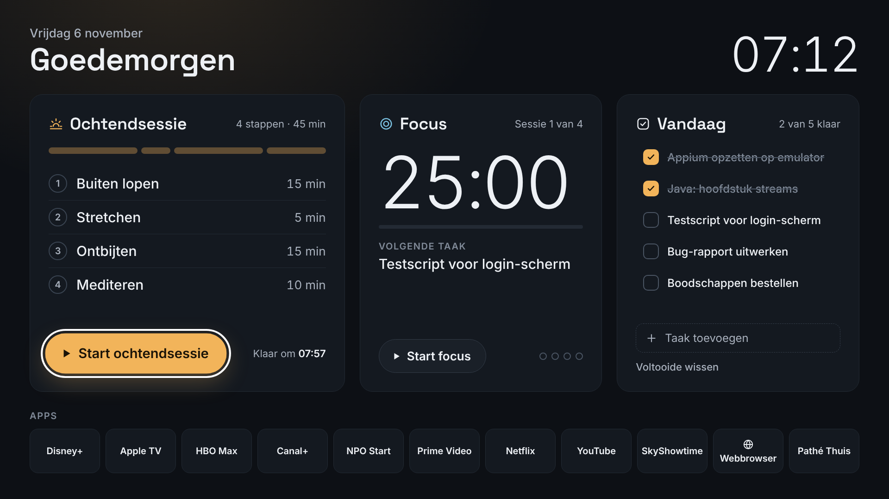
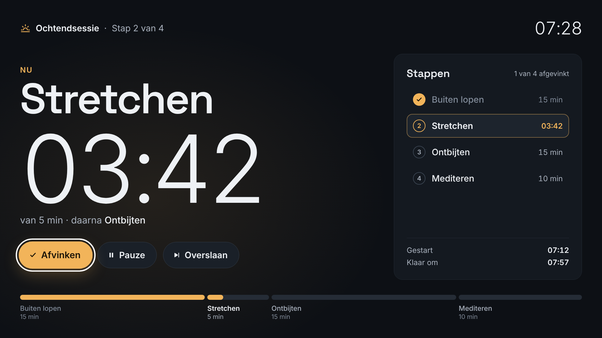
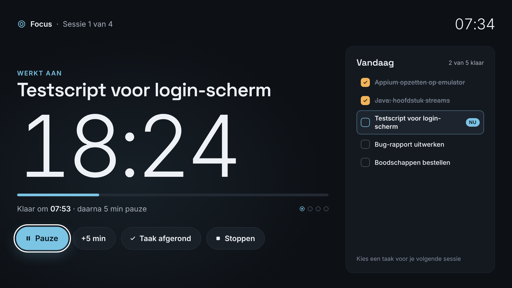

# Focus Dashboard voor LG webOS

Een eigen productiviteitsdashboard voor je LG-TV, gebouwd voor de QNED85T6A (webOS 24). Je vinkt je ochtendsessie stap voor stap af, werkt met een focus-timer aan je takenlijst en opent je streaming-apps vanaf één scherm.



## Wat zit erin

- **Ochtendsessie.** Je loopt stap voor stap je ochtend door: buiten lopen (15 min), stretchen (5), ontbijten (15) en mediteren (10). Elke stap heeft een timer en een geluidssignaal als de tijd om is. Daarna vink je de stap af. De balk laat zien hoeveel tijd elke stap krijgt, en na afloop zie je hoeveel dagen op rij je het volhoudt.
- **Focus-timer.** 25 minuten focus en dan 5 minuten pauze; na elke vierde sessie wordt de pauze 15 minuten. Je kiest een taak uit je lijst en vinkt die na de sessie direct af.
- **Vandaag.** Je takenlijst, aan te vullen via het schermtoetsenbord van de TV. Afgevinkte taken verdwijnen de volgende dag vanzelf.
- **App-tegels** voor Disney+, Apple TV, HBO Max, Canal+, NPO Start, Prime Video, Netflix, YouTube, SkyShowtime, de webbrowser en Pathé Thuis.
- Je bedient alles met de pijltjestoetsen of met de aanwijzer van de Magic Remote. Je gegevens worden op de TV zelf bewaard.

| Ochtendsessie | Focus |
|---|---|
|  |  |

## Installeren op je TV

### 1. Developer Mode aanzetten (eenmalig)

1. Installeer de app **Developer Mode** uit de LG Content Store en log in met je LG developer-account.
2. Zet **Dev Mode Status** aan. De TV start opnieuw op.
3. Open Developer Mode opnieuw en zet **Key Server** aan. Je ziet nu het IP-adres en de passphrase van je TV.

### 2a. Installeren met de webOS CLI

Hiervoor heb je Node.js op je computer nodig.

```bash
npm install -g @webos-tools/cli
```

Voeg je TV toe en vervang het IP-adres door dat van je TV:

```bash
ares-setup-device -a tv -i "username=prisoner" -i "host=192.168.1.50" -i "port=9922"
```

Haal de sleutel op en vul de passphrase in die de Developer Mode-app laat zien:

```bash
ares-novacom --device tv --getkey
```

Verpak de app en installeer hem (vanuit de map van deze repository):

```bash
ares-package app
```

```bash
ares-install --device tv com.boukaria.focusdashboard_1.0.0_all.ipk
```

```bash
ares-launch --device tv com.boukaria.focusdashboard
```

### 2b. Zonder command line

Bij elke push naar `main` bouwt GitHub het installatiebestand automatisch. Je vindt het onder **Actions** → de laatste run → *focus-dashboard-ipk*. Installeer dat `.ipk`-bestand met [webOS Dev Manager](https://github.com/webosbrew/dev-manager-desktop), dat er is voor Windows, macOS en Linux.

## Snel openen

- **Cijfertoets (Quick Access).** Open het dashboard, houd een cijfer van 1 tot 8 op je afstandsbediening ingedrukt en bevestig. Daarna start die toets het dashboard direct.
- Zet de app vooraan in de app-balk van je thuisscherm.
- Automatisch starten zodra de TV aangaat, ondersteunt LG niet. Gebruik je Home Assistant, dan kan een automatisering de app openen als de TV aangaat.

## Bediening

| Toets | Wat het doet |
|---|---|
| Pijltjes | Navigeren |
| OK | Kiezen of afvinken |
| Terug | Naar Home; op Home sluit je het dashboard |
| Play/Pauze | Timer pauzeren of hervatten |
| Rood | Geselecteerde taak verwijderen |
| Blauw of Info | Diagnose: laat zien welke app-ID's gevonden zijn |

## Aanpassen

Alle instellingen staan in [`app/js/config.js`](app/js/config.js):

- `routine.steps` bevat je ochtendstappen en hun minuten.
- `focus` bevat de focus- en pauzeduur en je dagdoel.
- `apps` bepaalt welke tegels er zijn en in welke volgorde.

Verpak en installeer de app daarna opnieuw (stap 2).

## App-ID's vinden

Het dashboard zoekt elke app op twee manieren: eerst met de ID uit `config.js` en daarna op naam. Lukt dat allebei niet, dan staat er **ID instellen** of **Niet gevonden** op de tegel. Zo vind je de juiste ID:

1. Open de app op je TV, bijvoorbeeld NPO Start.
2. Voer op je computer uit:

   ```bash
   ares-launch --device tv --running
   ```

3. Zet de ID die je bij die app ziet in `config.js`.

De ID's van Netflix (`netflix`), YouTube (`youtube.leanback.v4`), Prime Video (`amazon`), Disney+ (`com.disney.disneyplus-prod`), Apple TV (`com.apple.appletv`) en de webbrowser (`com.webos.app.browser`) komen uit openbare lijsten. Druk op de blauwe knop om te zien of ze op jouw TV kloppen.

## Goed om te weten

- **Developer Mode verloopt na 1000 uur (ongeveer 6 weken).** Open de Developer Mode-app op tijd en druk op EXTEND. Vergeet je dat, dan verwijdert de TV het dashboard samen met je taken en je reeks. Opnieuw installeren is één commando.
- **Screensaver.** Zolang er een timer loopt, probeert het dashboard de screensaver van de TV tegen te houden. Niet elke firmware staat dat toe.
- **Andere apps.** Een timer loopt gewoon door als je tussendoor een andere app opent. Het geluidssignaal hoor je alleen als het dashboard op het scherm staat.
- **Grote webOS-updates (26/27).** LG voert toegangsrechten (ACG) in voor apps. Opent het dashboard na een update geen apps meer, voeg dan in `app/appinfo.json` toe: `"requiredACG": ["application.launcher", "application.query"]`. Bij het verpakken zie je hierover nu een waarschuwing; die mag je negeren.

## Ontwikkelen

- Open `app/index.html` in Chrome. Met de pijltjes, Enter en Esc bedien je het dashboard zoals op de TV; app-tegels tonen dan alleen een melding.
- Testen op de TV zonder te installeren:

  ```bash
  ares-launch --device tv --hosted app
  ```

- Debuggen met de Web Inspector:

  ```bash
  ares-inspect --device tv --app com.boukaria.focusdashboard --open
  ```

## Licenties

- De lettertypes Inter en Space Grotesk vallen onder de SIL Open Font License (zie `app/fonts`).
- webOSTV.js is © LG Electronics en valt onder Apache 2.0 (zie `app/lib`).
